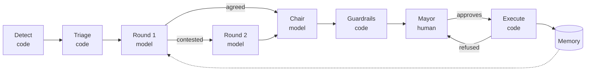

# Metropolis

A 3D city-builder that runs in the browser, built with TypeScript, Vite and Three.js.

```
npm install
npm run dev        # http://localhost:5173
```

Other commands: `npm test` (simulation, AI and render tests), `npm run check` (type check),
`npm run eval:offline` (evaluates the AI with no model calls; writes `docs/EVALUATION.md`),
`npm run shots` (Playwright screenshots into `screenshots/`), `npm run assets` (re-download
CC0 textures and skies).

## Playing

Lay a street, place a power plant and a water tower beside it, then zone land along the
road for homes, shops and industry. Watch the demand bars, keep the budget in the black
(B), and add services and parks to raise happiness. The Views menu (V) shows what is
going on: power, water, traffic, pollution, crime, land value, happiness and coverage.

The goal card at the top left leads the way: sixteen goals from the first street to a
Metropolis of 10,000, each paying a city grant (none in sandbox). Services include a hospital and a cricket ground (stands, pavilion, floodlights). An empty treasury is not
a free pass: while the funds are below zero, services are underfunded and residents are
unhappier until the books are fixed.

## Controls

| Action | Input |
|---|---|
| Move | W A S D or arrow keys, Shift + drag, or push the screen edge |
| Rotate / tilt | Q E / R F, or right-drag (Alt + drag on a trackpad) |
| Zoom | Scroll or pinch |
| Use a tool | Left click (drag to zone). Right click or Esc steps back |
| Inspect a building | Click it with no tool selected |
| Bulldoze / curved roads | X / C |
| Speed | Space to pause, 1 2 3 (normal, twice, four times as quick) |
| Budget / data views / menu | B / V / M |
| Light | Click the clock: Auto, Day, Night. The clock itself always shows the city's time |
| Dev overlay | ` (backtick) |

Cities are saved in the browser (Menu, M): three slots plus an autosave every two minutes.

## Transit and the airport

Place bus stops beside roads (Transit): two or more on connected roads start a bus line,
and buses run between them on the real roads, waiting at each stop. Residents near a served
stop leave the car at home and pay fares. The metro works the same way on a viaduct. An
airport, on a long flat site, earns from exports, travellers and tourists, lifts demand for
shops and industry, and is noisy around the runway. People walk the pavements and wait at
the stops.

## Seasons

The calendar is the ordinary one (a new city starts in March 2030); the weather follows
India's climate. Summer heat in May and June raises power and water demand, the monsoon in
July and August brings rain that slows traffic, and January and February mornings are
foggy. Days are long in summer and short in winter, and grass and leaves change colour.
The weather chip in the top bar says what the season is doing to the city.

## Time

The city has one clock. A game hour takes a real minute at normal speed; the budget settles
on the hour, so every income and upkeep figure is per hour. Twenty-four hours make a day,
with rush hours at about 9:00 and 18:00, and the sun follows the same clock. Each day stands
for a month, so a year passes in twelve game days.

## AI city council

Problems in the city (rush-hour jams, shortages, pollution, missing services, deficits)
bring the responsible minister to you. Call the council and nine AI ministers debate the
options the game has worked out, in English or Hindi; you approve the result.

To use real AI, copy `.env.example` to `.env`, add one or more OpenAI-compatible providers
(Gemini, Groq, OpenRouter and similar), and restart `npm run dev`. Without keys, or when a
free tier is rate-limited, the meeting runs offline with rule-based ministers at no cost.
Keys stay on your machine and are never sent to the browser.

### How the council works

The council is a multi-agent decision-support pipeline with the game as the source of
truth. The model argues; code decides what is possible, checks what was said, and carries
out what the mayor approves.




| Stage | What happens |
|---|---|
| Detect | Detectors in the simulation raise an issue with a severity and measured facts. |
| Triage | All nine ministries score how urgent it is for them; the lead and top three are seated. |
| Options | The game drafts valid options and runs each on a copy of the city to measure its effect. |
| Debate | Each minister sees only its own department and its slice of each option. Round 2 runs only if they disagree. |
| Chair | The Chief Secretary recommends one option, as schema-checked JSON. |
| Guardrails | Code checks the recommendation: it exists, the game accepts it, the city can pay, the figures quoted were in the facts shown. |
| Mayor | You approve, overrule or defer. An instruction you type first ("under $5,000, no demolition") is parsed into rules the council cannot break. |
| Execute | The option runs as one transaction and the city is compared with what the option card promised. |

A meeting is capped at 8 model calls (typically 4 or 5). Press **I** (anywhere), or open
Council > AI inspector, to watch it: the pipeline state, each agent's prompt and JSON,
latency, token counts, schema results and guardrail findings. Past decisions are
remembered per city, together with whether they fixed the problem, and shown to the
ministers they concern. The "Ask" assistant runs on the same instruments, and sends the
model only the parts of the manual a question touches.

`docs/GENAI_GUIDE.md` explains the design, the trade-offs and the numbers in full.
`npm test` covers all of it without calling a model; `REAL_COUNCIL=1 npx vitest run
tests/game/zz-real.test.ts` holds one real meeting and prints its telemetry.

### Evaluation at zero tokens

`npm run eval:offline` evaluates the AI layer in about ten seconds with the network
switched off: towns built with one known fault each (is it detected and given to the right
ministry?), every option executed on a fork and compared field by field with the payload
the agents were shown, whole meetings with no model, thirteen planted faults (invented
figures, prompt injection in the mayor's note, unaffordable or forbidden recommendations,
broken JSON), the instruction parser in English, Hindi and Hinglish, and a calibration of
the code checks against an LLM judge on 92 real statements from an earlier paid run. The
report is [docs/EVALUATION.md](docs/EVALUATION.md); the headline scores also appear in the
AI inspector.

## Hosting

`npm run build` produces a static site in `dist/` (about 75 MB, mostly textures and skies).
On any static host the game is complete and the council runs with its offline ministers.

For live AI, deploy to Vercel (`vercel.json` and the functions in `api/` are ready) and set
the provider variables from `.env.example` in the project's environment settings. The
hosted endpoint is always guarded: per-visitor and per-day call limits
(`LLM_CALLS_PER_VISITOR`, default 30 per ten minutes; `LLM_CALLS_PER_DAY`, default 500),
a prompt-size limit and an output-token cap, so a public page cannot drain a free tier.
The counters live in memory per warm instance, so the true ceiling is a small multiple of
those numbers; a shared store would make it exact. Visitors over a limit get the offline
council, not an error.

## Project docs

- `PLAN.md`: architecture, data model, phases and acceptance criteria.
- `PROGRESS.md`: what is done, what is next, known issues and decisions.
- `docs/GENAI_GUIDE.md`: the AI council explained end to end, with interview questions.
- `ASSETS.md`: every third-party asset and its licence (all CC0).
