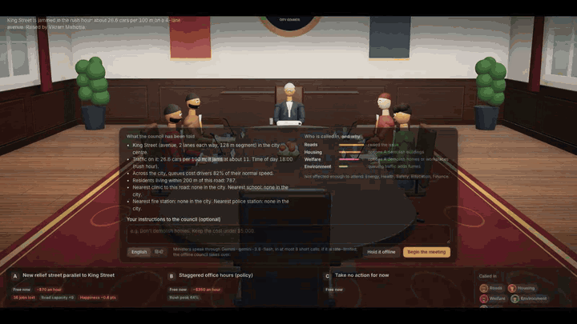
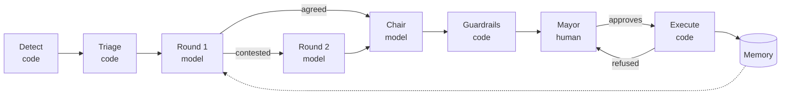
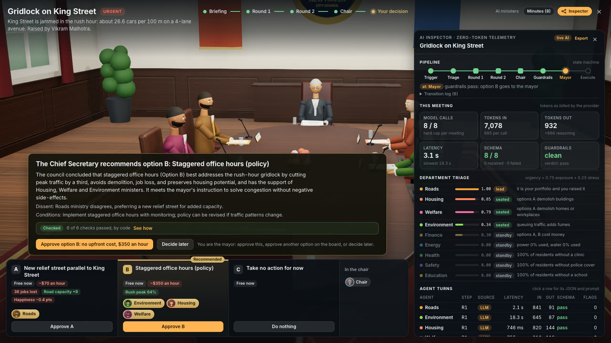
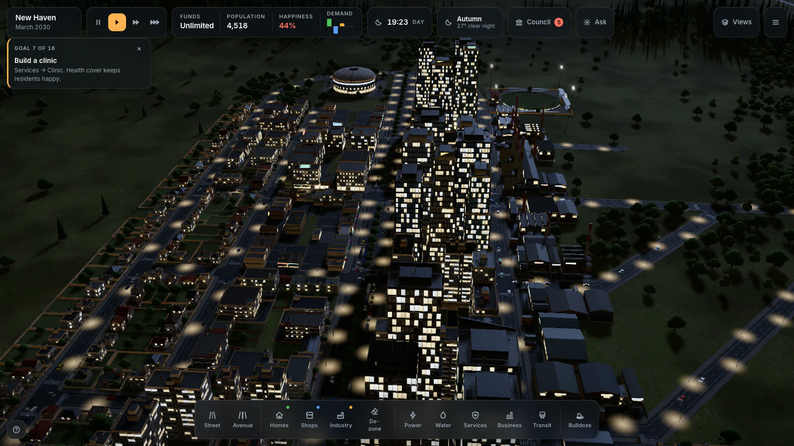
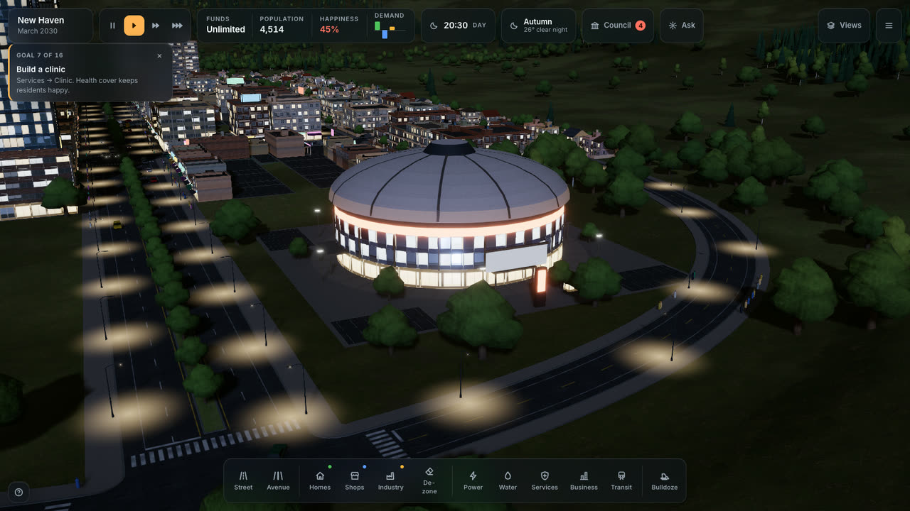
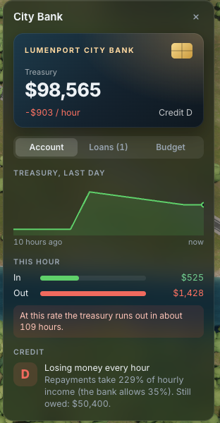
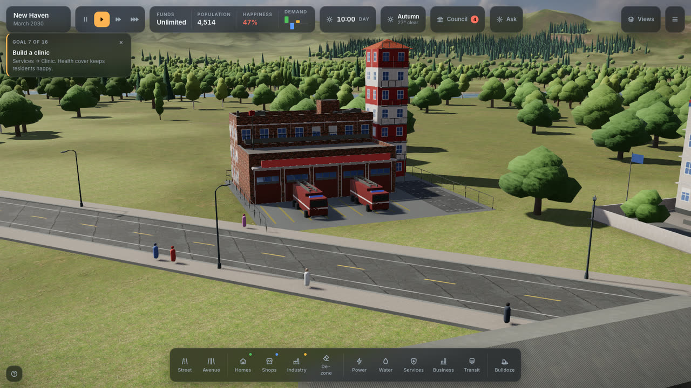
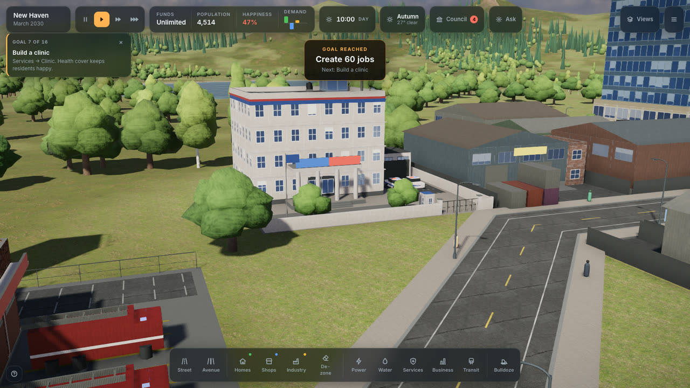

# Lumenport

**A 3D city-builder in the browser, governed with an AI council.**
Build a city street by street; when something goes wrong, nine AI ministers argue the
options from your city's real numbers, code checks every figure and rule, and you, the
mayor, make the call.

**[▶ Play it now: lumenport.vercel.app](https://lumenport.vercel.app)** · no install, runs
in any modern browser · TypeScript, Three.js, multi-agent LLMs


## The AI council



[▶ Watch a full meeting with live AI (MP4, 1 minute, 2x speed)](docs/media/council-meeting.mp4)

A rush-hour jam, a power shortage or a deficit brings the responsible minister to you.
Call the council and the ministers debate the options the game has worked out, in English
or Hindi. **The model argues; code decides** what is possible, checks what was said, and
carries out what the mayor approves.



| Stage | What happens |
|---|---|
| Detect | Detectors in the simulation raise an issue with a severity and measured facts. |
| Triage | All nine ministries score how urgent it is for them; the lead and the top three are seated. |
| Options | The game drafts valid options and runs each on a copy of the city to measure its effect. |
| Debate | Each minister sees only its own department's slice of each option. Round 2 runs only if they disagree. |
| Chair | The Chief Secretary recommends one option, as schema-checked JSON. |
| Guardrails | Code checks the recommendation: it exists, the game accepts it, the city can pay, every figure quoted was in the facts shown. |
| Mayor | You approve, overrule or defer. An instruction typed first ("under $5,000, no demolition") becomes rules the council cannot break. |
| Execute | The option runs as one transaction, and the city is compared with what the option card promised. |



- **Cheap by design.** A meeting is capped at 8 model calls; the one above used 8 calls,
  7,078 tokens in and 932 out. An uncontested meeting skips round 2.
- **Never stuck.** Without keys, or when a free tier is rate-limited, each seat falls back
  to a rule-based minister at no cost, and the meeting carries on.
- **Observable.** Press **I** for the AI inspector: pipeline state, each agent's prompt and
  JSON, latency, token counts, schema results and guardrail findings.
- **Memory.** Past decisions are remembered per city, with whether they fixed the problem,
  and shown to the ministers they concern.
- **The Ask assistant** answers questions about your city from its live data, and sends
  the model only the parts of the manual a question touches.

### Evaluated without spending tokens

`npm run eval:offline` evaluates the AI layer in about ten seconds with the network switched
off ([full report](docs/EVALUATION.md)):

| What is measured | Result |
|---|---|
| Built-in problems detected and handed to the right ministry | 6 / 6 |
| Option payloads that match a real execution on a fork, field by field | 15 / 15 |
| Offline meetings that reach a checked recommendation | 6 / 6 |
| Planted faults caught by code (invented figures, prompt injection, broken JSON, forbidden or unaffordable picks) | 13 / 13 |
| Mayor's instructions parsed exactly (English / Hindi and Hinglish) | 20 / 20, 8 / 8 |
| Assistant questions routed to the right manual section | 24 / 24 |
| Code grounding check agreeing with an LLM judge on 92 recorded statements | 85% |

## The city



[▶ City at dusk (MP4, 10 seconds)](docs/media/city.mp4)

- **Build:** streets and avenues (straight or curved), homes, shops and industry at three
  densities, power, water, services, transit, an airport. Everything costs money: roads by
  the metre, buildings by the building, zoning by the cell.
- **Grow up:** services come small and big. A police station and, from 3,000 residents, a
  police headquarters; a fire station and a central fire station; a clinic and a hospital;
  a cricket ground and a domed indoor stadium. Sixteen goals lead from the first street to
  a metropolis of 10,000.
- **Money:** a City Bank with a treasury chart, a credit rating and loans that the bank
  grants by city size and income. Taxes move demand; an empty treasury makes people unhappy.
- **A living city:** traffic on every road with rush hours, buses and a metro on its
  viaduct, people on the pavements, Indian seasons (summer heat, monsoon rain, winter fog)
  on a day and night cycle, and an AI that reads all of it.
- **Accounts:** play first, sign in later (passwordless email or Google) to keep cities in
  the cloud and carry on from any device.

| | |
|---|---|
|  |  |
|  |  |

## Controls

| Action | Input |
|---|---|
| Move | Drag the map, two-finger swipe on a trackpad, W A S D or arrow keys |
| Rotate / tilt | Q E / R F, right-drag, or twist two fingers on a touch screen |
| Zoom | Mouse wheel or pinch |
| Use a tool | Left click (drag to zone). Right click or Esc steps back |
| Inspect a building | Click it with no tool selected |
| Speed | Space to pause, 1 2 3 |
| City Bank / data views / menu / AI inspector | B / V / M / I |

## Run it locally

```
npm install
npm run dev        # http://localhost:5173
```

The game is complete without any keys: the council then runs on its rule-based ministers.
For live AI, copy `.env.example` to `.env` and add one or more OpenAI-compatible providers
(Gemini, Groq, OpenRouter and similar). Keys stay on the server and never reach the browser;
players can also use their own key (Menu > AI).

| Command | What it does |
|---|---|
| `npm test` | Simulation, AI and render tests (no model calls) |
| `npm run check` | Type check |
| `npm run eval:offline` | The zero-token AI evaluation; writes `docs/EVALUATION.md` |
| `npm run build` | Static build in `dist/` |

**Accounts (optional):** create a [Supabase](https://supabase.com) project, run
`supabase/schema.sql` in its SQL editor (the table and the row-level security that lets
each player see only their own cities), add the game's address to the redirect URLs, and
set `VITE_SUPABASE_URL` and `VITE_SUPABASE_ANON_KEY`. Without them, saves stay in the
browser.

**Hosting:** deploys to Vercel as it is (`vercel.json`, functions in `api/`). The hosted AI
endpoint is always guarded: per-visitor and per-day call limits, a prompt-size limit and an
output-token cap, so a public page cannot drain a free tier; visitors over a limit get the
offline council, not an error.

## Built with

TypeScript (strict) · Three.js · Preact · Vite · zod · Supabase · Vercel serverless ·
Playwright and Vitest. Textures and skies are CC0 ([ASSETS.md](ASSETS.md)).

## Authors

Built by **Mohit** ([@Mohitoo6](https://github.com/Mohitoo6)) and **Rohit**
([@Rohit-0612](https://github.com/Rohit-0612)).
